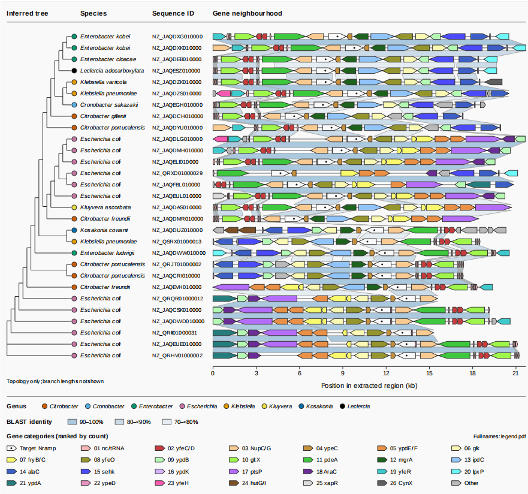

# Enterobacteriaceae Cd Uptake Comparative Genome Synteny

[](https://doi.org/10.5281/zenodo.24089973)

Compare cadmium-uptake gene neighborhoods using BEDTools, BLAST, MAFFT, IQ-TREE
and species-annotated synteny plots. Three entries support reference reproduction,
curated reconstruction, and automatic target discovery. FASTA/GFF data for 29
assemblies and all reference inputs are included.

## Installation

Supported: **Linux x86_64 / Windows WSL2 x86_64**, glibc >=2.28. Use a Linux
filesystem on WSL2. Requirements and versions: [DEPENDENCIES.md](DEPENDENCIES.md).

With Miniforge/Conda, Python >=3.9 and GNU coreutils available, run from the
repository root:

```bash
conda create --yes --prefix .tools/r --file environment/conda_linux_64.lock
conda activate "$PWD/.tools/r"
make setup
make check
make verify-main
```

Setup installs locked tools into `.tools/` and R packages into `.r_library/`;
installation requires internet. Tool lookup: explicit override, repository
`.tools`, then PATH. After relocation, restore environments and compiled packages
at the destination. Keep all tracked data, locks and fonts.

## Three entries

| Entry | Inputs | Output |
| --- | --- | --- |
| `plot-main` | Supplied tables, reference tree, species metadata | `results/main/` |
| `plot-curated` | Original FASTA/GFF, manual annotations, species metadata | `results/curated/` |
| `plot-auto` | Original FASTA/GFF, species metadata, target name | `results/auto/` |

### Main: reproduce the reference figure

| Required file | Key checks |
| --- | --- |
| `data/sequences.csv` | Unique `seq_id`, positive `length`; preserve sequence order |
| `data/genes.tsv` | `seq_id`, `start`, `end`, `strand`, `note`, `organisms`; targets use `note=Uptake-Gene` |
| `data/reference_blast_hits.csv` | IDs and coordinates refer to indexed regions |
| `data/phylogeny.nwk` | Newick tree with exactly one tip per indexed sequence |
| `data/genomes.tsv` | Sequence IDs map to assemblies and species names |

```bash
make check-data
make plot-main
```

Main uses these fixed filenames and requires only R and basic system commands.

### Curated: reconstruct with manual annotations

Required: `data/genomes/`, `data/genomes.tsv`, and `data/genes.tsv` (the supplied
`29gene2.txt`). Manual annotations define region bounds; extraction, BLAST,
alignment and tree inference run from the original genomes.

Metadata needs unique `seq_id`, plus `assembly_accession` and `organism_name`.
Annotations need `seq_id`, `start`, `end`, `strand`, `type`, `feat_id`, `geom_id`,
`note` and `organisms`. Each sequence needs a target row and feature IDs matching
the GFF. Preserve the supplied historical one-base start offset for exact FASTA
reproduction.

```bash
make plot-curated
# Optional comparison with the supplied fragments.
cmp data/reference_sequences.fasta results/curated/extracted_sequences.fasta
```

### Automatic: discover targets from genome annotations

Required: original FASTA/GFF, species metadata and a target query. Manual
annotations and historical analysis files are not used. Genome layout for both
reconstructed entries:

```text
data/genomes/
  GCF_003470965.1/
    genome.fna.gz
    annotation.gff.gz
  ...
data/genomes.tsv
```

Uncompressed `genome.fna` and `annotation.gff` are accepted. FASTA contig names
must match GFF sequence IDs. GFF needs parent genes, CDS features, `ID`/`Parent`
relationships, and gene or product descriptions. Index every assembly directory
in the tab-separated metadata table; automatic metadata minimally needs:

```tsv
assembly_accession	organism_name
GCF_003470965.1	Escherichia coli
```

```bash
make plot-auto TARGET_GENE=Nramp NEIGHBORS=10
```

`Nramp` matches `mntH` gene names or products containing `Nramp`. Other queries
match gene names or whole product tokens case-insensitively in existing GFF
annotations. Inspect `results/auto/target_matches.tsv` for matches and exclusions.

All eligible target copies are retained. `NEIGHBORS=10` selects up to ten coding
parent genes per genomic side, not 10 kb. CDS fragments count through their parent
gene; RNAs and pseudogenes are excluded. Contig ends truncate the window without
compensation. Tree inference requires at least four regions.

## Local and Slurm execution

Default CPU budget: **56**, configurable with `THREADS`.

```bash
make run THREADS=56                  # Generate all three figures locally.
make verify THREADS=56               # Build and validate all three entries.
make submit TARGET=plot-auto THREADS=56
make submit TARGET=verify-curated THREADS=56 \
  SLURM_PARTITION=compute SLURM_NODE=nodeA SLURM_TIME=04:00:00 SLURM_MEMORY=32G
make -s submit TARGET=plot-auto SUBMIT_DRY_RUN=1
```

BLAST, MAFFT and IQ-TREE receive `THREADS`; preparation uses up to
`min(THREADS, assembly count)` workers. Heavy stages run sequentially even under
`make -j`; plotting and short checks retain necessary serial work. Set `THREADS`
to fit the available CPUs.

Slurm requests one node and one task; partition/node default to scheduler choice.
Use your cluster's settings. CPU checks run on the compute node; direct Make
commands also work inside an allocation. Logs: `results/slurm/`. Compute nodes
need shared access to the repository and tools.

## Optional parameters

Copy custom analysis inputs into the repository; tool executables may be
external. Quote paths and colors. Use a fresh working copy for a new dataset or
target setting.

### Resources and inputs

| Parameter | Default and meaning | Example |
| --- | --- | --- |
| `THREADS` | `56`; positive CPU budget for reconstructed entries and Slurm | `make plot-curated THREADS=56` |
| `TARGET_GENE` | `Nramp`; automatic query and reconstructed-figure target label | `make plot-auto TARGET_GENE=mntH` |
| `NEIGHBORS` | `10`; nonnegative coding genes per side, automatic only | `make plot-auto NEIGHBORS=5` |
| `GENOME_DIR` | `data/genomes`; curated/automatic FASTA/GFF directory | `make plot-auto GENOME_DIR=data/custom/genomes` |
| `GENOME_METADATA` | `data/genomes.tsv`; curated/automatic species index | `make plot-auto GENOME_METADATA=data/custom/genomes.tsv` |
| `GENE_ANNOTATIONS` | `data/genes.tsv`; curated only | `make plot-curated GENE_ANNOTATIONS=data/custom/genes.tsv` |
| `MODE` | `default` (default) or `replay`; reconstructed-tree mode | `make verify-auto MODE=replay` |
| `TARGET` | `verify`; entry/stage submitted to Slurm | `make submit TARGET=plot-main` |
| `SUBMIT_DRY_RUN` | `0`; set `1` to print submission JSON without submitting | `make -s submit TARGET=plot-auto SUBMIT_DRY_RUN=1` |

### Gene and homology-link palettes

| `GENE_PALETTE` | Meaning |
| --- | --- |
| `main-muted` (default) | Reference saturation multiplied by 0.70, extended to 42 colors |
| `automatic` | Seven hue families, six tones each |
| `nature` | NPG-inspired colors with lighter tones |
| `cell` | Project-defined soft Cell-inspired colors |
| `science` | AAAS-inspired colors with lighter tones |

Journal names indicate palette inspiration. `main-muted` preserves the reference
main mapping. Other main mappings and reconstructed entries rank categories by
count descending, then name descending, with up to 42 colors; overflow becomes
gray `Other`. Automatic labels prefer gene names, then products. Targets are
white with black dots.

`LINK_PALETTE`: `blue` (default), `green`, `purple`, `orange` (three pale tones),
or `original` (historical grays). `LINK_COLORS` is unset by default; override the
preset with three distinct comma-separated `#RRGGBB` values, ordered by identity:
**>=90%, 80–<90%, 70–<80%**.

```bash
make plot-main GENE_PALETTE=main-muted LINK_PALETTE=blue
make plot-curated GENE_PALETTE=automatic LINK_PALETTE=green
make plot-auto GENE_PALETTE=nature LINK_PALETTE=purple
make plot-main GENE_PALETTE=cell LINK_PALETTE=orange
make plot-auto GENE_PALETTE=science LINK_PALETTE=original
make plot-auto LINK_COLORS="#AECDE3,#D0E1EE,#EBF3F8"
```

### Executables and scheduler settings

| Parameter | Default / meaning | Example |
| --- | --- | --- |
| `PYTHON` | `python3` on PATH | `make check PYTHON=/opt/python/bin/python3` |
| `RSCRIPT` | Repository R, then PATH | `make plot-main RSCRIPT=/opt/R/bin/Rscript` |
| `BEDTOOLS` | Repository binary, then PATH | `make prepare-auto BEDTOOLS=/opt/bedtools/bin/bedtools` |
| `BLASTN` | Repository BLAST, then PATH | `make blast-auto BLASTN=/opt/blast/bin/blastn` |
| `MAKEBLASTDB` | Repository BLAST, then PATH | `make blast-auto MAKEBLASTDB=/opt/blast/bin/makeblastdb` |
| `MAFFT` | Repository MAFFT, then PATH | `make phylogeny-auto MAFFT=/opt/mafft/bin/mafft` |
| `IQTREE` | Repository IQ-TREE, then PATH | `make phylogeny-auto IQTREE=/opt/iqtree/bin/iqtree3` |
| `SLURM_PARTITION` | Unset; scheduler default | `make submit TARGET=plot-auto SLURM_PARTITION=compute` |
| `SLURM_NODE` | Unset; scheduler chooses | `make submit TARGET=plot-auto SLURM_NODE=nodeA` |
| `SLURM_TIME` | Unset; scheduler default | `make submit TARGET=plot-auto SLURM_TIME=04:00:00` |
| `SLURM_MEMORY` | Unset; scheduler default | `make submit TARGET=plot-auto SLURM_MEMORY=32G` |

Versions must match [DEPENDENCIES.md](DEPENDENCIES.md). Supply both BLAST
executables for a separate installation.

## Stages, replay and redraw

Stages: `prepare-curated`, `blast-curated`, `phylogeny-curated`, and corresponding
`*-auto` targets. `verify-main`, `verify-curated` and `verify-auto` build and
validate an entry. `check-data` checks bundled input hashes; `check` also checks
tools.

```bash
make prepare-auto THREADS=56 TARGET_GENE=Nramp NEIGHBORS=10
make blast-auto THREADS=56 TARGET_GENE=Nramp NEIGHBORS=10
make phylogeny-auto THREADS=56 TARGET_GENE=Nramp NEIGHBORS=10
make verify-auto THREADS=56             # Record a run before replay.
make verify-auto THREADS=56 MODE=replay
```

MAFFT/IQ-TREE use default analysis settings with resource flags. Seeds, models and
commands are recorded. Replay requires the entry's completed
`phylogeny/replay_manifest.json` and writes to `phylogeny_replay/`. Tree caches
require matching inputs, scripts, tool builds and threads. Default runs or
different hardware may produce different inferred trees.

Redraw existing results without running extraction or inference:

```bash
Rscript --vanilla scripts/plot_synteny.R --entry auto --target-gene Nramp \
  --gene-palette main-muted --link-palette blue
Rscript --vanilla scripts/verify_results.R --entry auto --target-gene Nramp \
  --gene-palette main-muted --link-palette blue
# Use a replay tree and custom link colors.
Rscript --vanilla scripts/plot_synteny.R --entry auto \
  --input-dir results/auto --phylogeny-dir results/auto/phylogeny_replay \
  --gene-palette nature --link-colors "#AECDE3,#D0E1EE,#EBF3F8"
```

Both R scripts accept `--entry main|curated|auto`, `--target-gene NAME`,
`--gene-palette NAME`, `--link-palette NAME`, `--link-colors HEX,HEX,HEX`,
`--input-dir PATH` (prepared tables) and `--phylogeny-dir PATH` (inferred tree).
Use the same options for plotting and verification.

## Outputs and notes

Each output directory contains a vector `synteny.pdf`, a 600-dpi `synteny.png`,
caption, color mappings and audit tables. Reconstructed entries also include
`legend.pdf`, extracted FASTA, annotations, BED regions, BLAST, alignments, trees
and execution records.

- Species labels come from assembly metadata.
- GFF is 1-based inclusive; BED is 0-based half-open. Automatic local coordinates
  are 1-based inclusive; curated retains its historical offset.
- No automatic target gives a diagnostic table and an error; previous outputs do
  not represent that query.
- Results and installed environments are Git-ignored; share needed results
  separately.

## Citation

Chen, J. (2026). *Enterobacteriaceae Cd Uptake Comparative Genome Synteny*
(v1.0.0) [Software]. Zenodo.
[https://doi.org/10.5281/zenodo.24089974](https://doi.org/10.5281/zenodo.24089974).
Machine-readable citation metadata: [CITATION.cff](CITATION.cff).

## License

Original project code, configuration, tests and documentation are licensed under
the [MIT License](LICENSE). Keep its copyright and permission notice when
redistributing the software.

Bundled inputs in `data/`, including genome FASTA/GFF, curated annotations and
reference analysis files, retain their original source terms and are not
relicensed under MIT. Assembly accessions are recorded in
[`data/genomes.tsv`](data/genomes.tsv); see the
[NCBI data usage policy](https://www.ncbi.nlm.nih.gov/home/about/policies/).
Bundled fonts retain their [SIL Open Font License](environment/fonts/LICENSE).
Dependencies retain their respective licenses.
